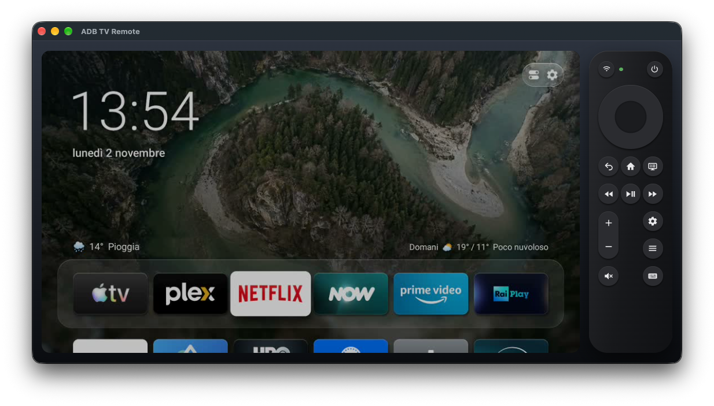

# ADB TV Remote

Control your Fire TV or Android TV from your computer, and see its screen while you do.



It talks to the TV over your home network. There is no account, no cloud service, and nothing to install on the TV.

- **A full remote:** D-pad, OK, Back, Home, Menu, media keys, volume, mute, TV guide and power.
- **A live picture of the TV**, right next to the buttons. Click on it to touch the screen.
- **Fast:** a key reaches the TV in about 15 milliseconds.
- **Long press** on OK, Back, Home and Menu.
- **Type on the TV** from your keyboard.
- **Several TVs:** save them and switch between them.
- **Updates itself** from this page.
- English and Italian.

## Download

**[Download the latest version](https://github.com/simplemal/adb-tv-remote/releases/latest)** for a Mac with Apple silicon: take the `.dmg` file, open it and drag the app to Applications.

Builds are signed but not yet notarized by Apple, so the first time macOS may block the app: open **System Settings → Privacy & Security** and choose **Open Anyway**. macOS also asks to let the app use the local network: allow it, or the app cannot reach the TV.

When a new version is out, the app downloads it by itself and shows a **New version ready** button. Press it when you like: the app restarts and is up to date.

## What works with it

### TVs and sticks

| Device | Status |
|---|---|
| Fire TV Stick 4K, 2nd generation (Fire OS 8) | **Tested:** everything works |
| Fire TV Stick 4K Max, 2nd generation (Fire OS 8) | **Tested in part:** it connects; the rest is being checked |
| Fire TV Stick 4K Max, 1st generation (Fire OS 7) | **Tested in part:** it connects and the keys work; picture, touch and standby are being checked |
| Other Fire TV devices with Fire OS | **Should work,** not tried yet |
| Android TV and Google TV with ADB on port 5555 | **Should work,** not tried yet |
| Devices that offer only Android 11 "Wireless debugging" with a pairing code | **Not yet:** the app cannot pair |
| Fire TV devices with Vega OS, such as the Fire TV Stick 4K Select | **No:** Vega is not Android |

If you try it on another device, please tell how it went in an [issue](https://github.com/simplemal/adb-tv-remote/issues).

### Computers

| Computer | Status |
|---|---|
| Mac with Apple silicon | **Tested,** ready to download |
| Mac with an Intel processor | No download: it can be built from the source on an Intel Mac |
| Windows and Linux | Prepared, but never tried: no download yet |

## First steps

**On the TV,** once only:

1. Open **Settings → My Fire TV → Developer Options** and turn on **ADB debugging**.
2. No Developer Options? Open **My Fire TV → About** and press OK seven times on the name of the device.

On Android TV and Google TV the path is different: look for Developer options and turn on USB debugging and, if it is listed, Network debugging.

**In the app:**

1. Enter the TV's IP address, or press **Find on network**.
2. A window appears on the TV: tick **Always allow from this computer** and choose **Allow**.

The computer and the TV must be on the same network. A guest Wi-Fi often keeps devices apart.

## Using it

The Wi-Fi key on the remote opens the list of TVs. Hold a key for a long press.

| Keyboard | Sends |
|---|---|
| Arrows | D-pad |
| Enter | OK |
| Esc or Backspace | Back |
| H | Home |
| M | Menu |
| Space | Play/pause |

**Find on network** only runs when you press it. It tries port 5555 on your local networks, and sends nothing to what it finds.

## Limits

- **No sound.** Sound does not come through ADB. On Fire OS 8 (Android 11), shell access to `REMOTE_SUBMIX` is refused, and scrcpy receives silence.
- **Protected video is black.** Netflix, Prime Video and similar apps show black while playing. The system decides this.
- **960×540 preview, one viewer at a time.** Do not run another screen recorder on the same device.
- **Latin text only.** `adb shell input text` cannot type most non-ASCII characters.
- **Not quite a real remote.** Accessibility services that filter keys may not see these keys.
- **Fire TV Screen Mirroring cuts off Wi-Fi** and ignores simulated keys, so avoid starting it from this app. To leave it, use the real remote, or USB with `adb shell am force-stop com.amazon.cast.sink`.
- **Power** sends `SLEEP` or `WAKEUP` by the device's state, because Fire OS ignores a simulated `POWER`. ADB stays on in standby.
- **Volume** acts on the device and, where supported, on the TV through HDMI-CEC.

## Run from source

You need [Node.js](https://nodejs.org) 22 or newer.

```sh
npm install
npm start
```

`npm start` uses `adb` and `ffmpeg` from `resources/bin` if you have prepared them (see below), and otherwise from your system: `brew install android-platform-tools ffmpeg` on macOS. Without ffmpeg the preview shows one picture at a time.

## Test

No device is needed: a fake `adb` (`test/fake-adb.js`) plays the device, and it never touches the network.

```sh
npm test               # logic, with the fake adb and a real ffmpeg decode
npm run test:e2e       # the real app window, driven end to end
npm run test:packaged  # the built app; run it after a macOS build
```

`test/e2e/real-adb.test.js` also runs the real adb against a pretend device on the loopback address, to check how the app reads adb's answers.

## Build

`npm run build:all` builds for macOS, Windows and Linux from an Apple Silicon Mac, outside the project folder, and puts the results in `dist/`. It takes ready-made LGPL FFmpeg builds for Windows and Linux (`scripts/fetch-ffmpeg.mjs`).

To build one package on the operating system it is for:

```sh
npm run build:mac     # dist/adb-tv-remote-<version>-<arch>.dmg and dist/mac-<arch>/*.app
npm run build:linux   # AppImage and .deb
```

These download Google's platform-tools, verify them, and compile a small FFmpeg, which needs a C compiler and `make`, plus `nasm` on Intel and AMD processors. macOS needs Xcode's command line tools.

For Windows, in an MSYS2 MinGW 64-bit shell with a compiler and `nasm` installed:

```sh
npm run prepare:bin
npm run build:win
```

For an Intel Mac, build on an Intel Mac. The Windows and Linux paths are prepared but have not been run yet.

Set `ADB_TV_REMOTE_ADB` or `ADB_TV_REMOTE_FFMPEG` to use a specific program instead of the search below.

## How it works

Electron's main process does all the work, in `src/main`. The page in `src/renderer` only draws and talks to it over a small bridge.

- **Keys and touches:** clicking the picture touches the device: hold for a long press, drag to scroll. Apps built only for the remote may ignore touches. `resources/keyinput/keyinput.dex` is copied to the device and run with `app_process`, as scrcpy does, and stays running. `input keyevent` is the fallback.
- **Picture:** `screenrecord` H.264 → ffmpeg → JPEG frames → window. A screenshot starts each session, and another one follows key presses once the video goes quiet, because the encoder emits only when the screen changes. `screenrecord` stops after 3 minutes and the app starts it again. Capture stops while the window cannot be seen (on macOS that includes a fully covered window) and while the device is in standby.
- **Checks:** every 5 seconds while the window can be seen, less often while the device is in standby or not answering, and not at all while the window cannot be seen. It is checked again the moment the window comes back.
- **Finding the tools:** `ADB_TV_REMOTE_*` override, then the copy in the app, then the system.

### Rules for contributors

Keep these. The tests enforce most of them.

- Never use `monkey --port` or `uiautomator`. They suspend the device's accessibility services and disconnect other services.
- Keep the ffmpeg arguments in `src/main/screen.js`. Never add `-fflags nobuffer`: with it the decoder produces nothing.
- Keep adb on its private server port.

### Why a private adb server

Every adb client and server must be the same version, and a mismatched client kills the running server. So the app runs its own server on `127.0.0.1:15037`, replaces any server it finds there on start, and stops it on quit. This cannot disturb Android Studio or any other adb on the computer. It shares `~/.android/adbkey`, so a device that already trusts this computer stays trusted.

### Why ship adb and ffmpeg

The app should work the moment it opens, so packaged builds include both. The system copies remain a fallback.

| Tool | What ships | Size | License |
|---|---|---|---|
| adb | Google's platform-tools 37.0.1, pinned by checksum | 19 MB | Apache-2.0 |
| ffmpeg | macOS: built by `scripts/build-ffmpeg.sh`, H.264 decoder, MJPEG encoder and nothing else. Windows and Linux from `npm run build:all`: full LGPL builds, pinned by checksum | 2 MB; 130-140 MB | LGPL-2.1-or-later |

Common ready-made ffmpeg builds, Homebrew's and `ffmpeg-static` among them, are GPL because they include x264. This app decodes H.264 and has no use for that, so a minimal build keeps the licensing simple. It also needs no network access. Details are in `THIRD_PARTY_NOTICES.md`.

The prebuilt adb comes under Google's SDK terms, whose section 3.5 leaves open-source components to their own license, and adb's source is Apache-2.0. scrcpy ships the same binary.

### Security

- No server and no open ports: the page and the main process talk over Electron IPC. A test checks that the app listens on nothing. adb's own server is on loopback only.
- `contextIsolation`, `sandbox` and a strict Content-Security-Policy are on, and Node.js is off in the page.
- The page can reach only a short list of actions. Keys come from a fixed list, addresses are checked, and text is quoted for the device's shell.
- Navigation, new windows, webviews and browser permissions are refused.
- Packaged builds turn off `ELECTRON_RUN_AS_NODE`, `NODE_OPTIONS` and the inspector flags, and check the integrity of the app archive.
- ADB gives full control of the TV to anyone on your network who is allowed in. The device asks before trusting a new computer: only accept your own. Turn ADB debugging off when you stop using this app.

## Rebuild the key helper

`resources/keyinput/KeyInput.java` is the source of `keyinput.dex`. You need a JDK and the Android SDK.

```sh
javac -cp "$ANDROID_HOME/platforms/android-34/android.jar" -d out resources/keyinput/KeyInput.java
"$ANDROID_HOME/build-tools/34.0.0/d8" --min-api 26 --output out out/KeyInput*.class
```

The result is `out/classes.dex`. Copy it over `resources/keyinput/keyinput.dex`.

## Signing and releasing

The default macOS build has an ad-hoc signature, so it needs no certificate. `npm run build:all` signs with a Developer ID certificate if the keychain has one, and notarizes if a notarytool profile is saved under the name `notarize` (`xcrun notarytool store-credentials notarize`). Neither is stored in this repository.

The app updates itself from this repository's releases: it downloads a new version in the background and offers a restart. On a Mac that needs the zip, `latest-mac.yml` and a build signed with the same certificate, so `build:all` leaves them in `dist` to attach to the release along with the dmg.

For every release, because of the LGPL:

1. Attach `.cache/ffmpeg/ffmpeg-<version>.tar.xz` to the same release as the binaries.
2. Keep `bin/FFmpeg-LICENSE.txt` and `bin/FFmpeg-BUILD-INFO.txt` in the package, and the FFmpeg credit on the download page.

## License

The source is public, and you are free to use, study, change and share it for any non-commercial purpose, but not to sell it. That makes it source-available rather than open source in the strict sense: see `LICENSE` (PolyForm Noncommercial 1.0.0) and `NOTICE.md`. This project is not affiliated with Amazon or Google: Fire TV, Android TV and Google TV are their trademarks. All trademarks belong to their owners. Packaged builds include third-party programs under their own licenses: see `THIRD_PARTY_NOTICES.md`.
